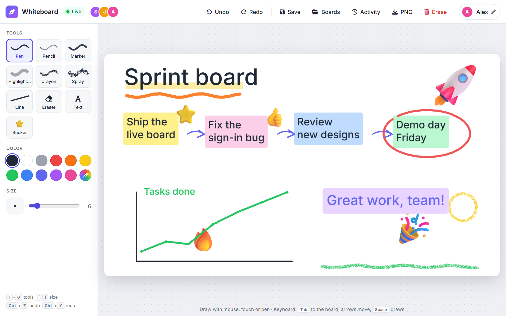
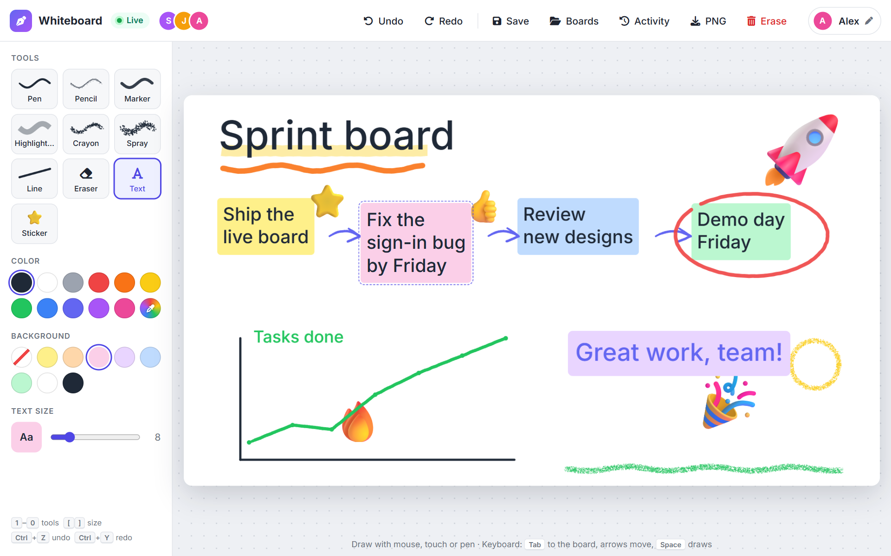
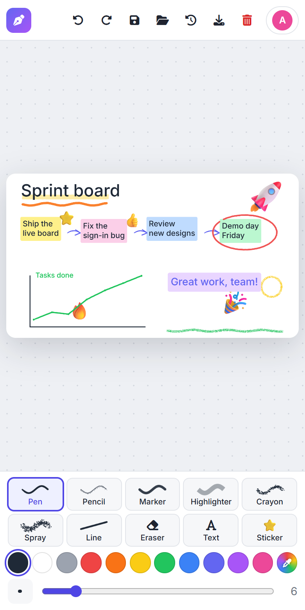
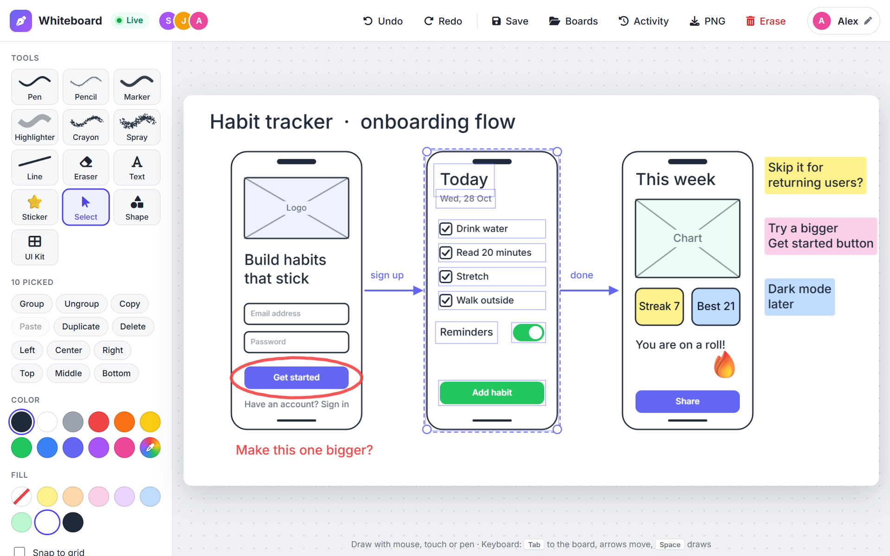
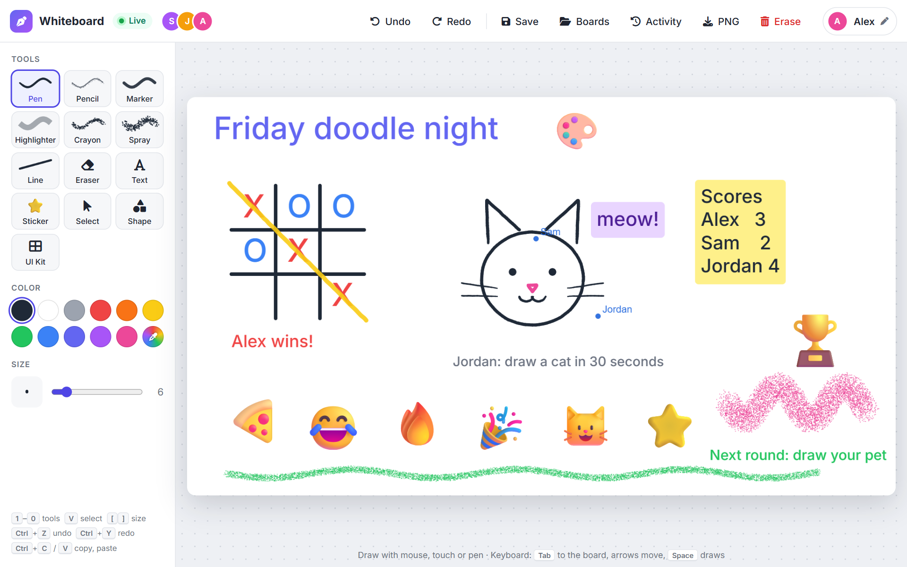
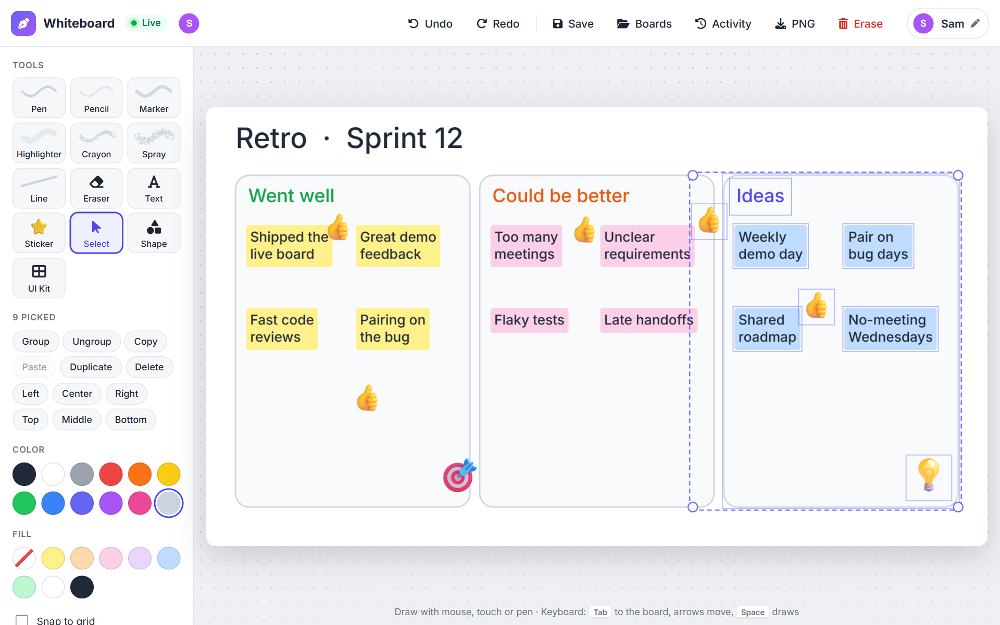
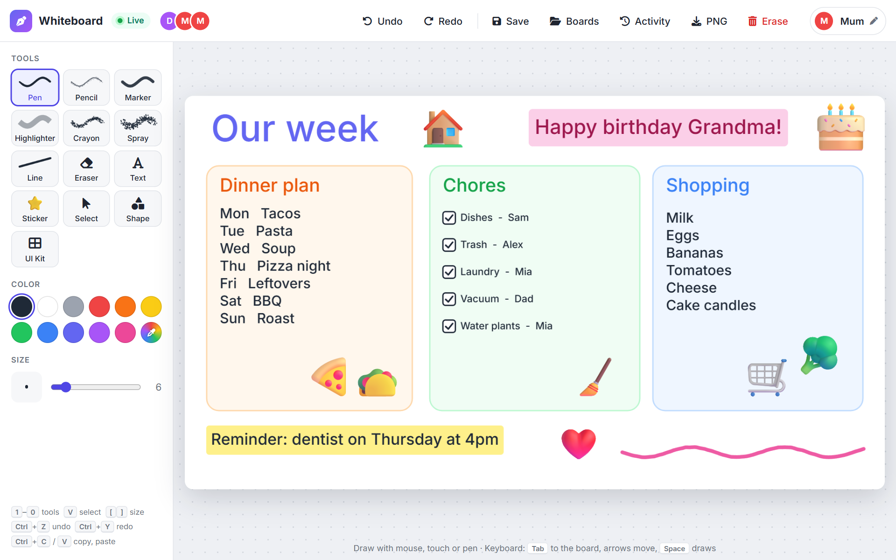

# Whiteboard

A shared whiteboard that stays on. Open it in a browser, sign in, and everyone sees each other draw in real time.
Good for a family fridge, a team wall display, or a classroom.



## What you can do

- **Draw together, live.** Pen, pencil, marker, highlighter, crayon, spray paint, lines and an eraser, with any color.
- **Add text and stickers.** Type a text box (with an optional background color), click it again later to edit it, or stamp an emoji sticker.
- **Sketch interfaces.** Shapes (rectangles, ellipses, diamonds, arrows) and a wireframe kit (button, input, checkbox, toggle,
  image, phone, browser window). Move, resize, recolor, fill and label them with the Select tool, and snap to a grid.
- **Undo and redo your own changes.** Never someone else's.
- **Keep your boards.** Save named copies, open them again, or download the board as a PNG.
- **Works on any screen.** Mouse, touch, pen or keyboard, on a phone, laptop or wall display.
- **Safe to leave running.** Password protected, remembers the board after a restart, backs up before erasing,
  and keeps a log of who did what.

<table>
  <tr>
    <td width="68%"></td>
    <td></td>
  </tr>
  <tr>
    <td align="center">Click a text box to change its text, color, size or background</td>
    <td align="center">Everything fits on one phone screen</td>
  </tr>
</table>

## Ways to use it

<table>
  <tr>
    <td width="50%"></td>
    <td width="50%"></td>
  </tr>
  <tr>
    <td><b>Prototype an app.</b> Sketch screens with phone frames, buttons, inputs and arrows. Group a screen, then move or resize it as one.</td>
    <td><b>Game night with friends.</b> Play tic-tac-toe, race to draw a cat, keep score, and watch everyone's cursors move live.</td>
  </tr>
  <tr>
    <td></td>
    <td></td>
  </tr>
  <tr>
    <td><b>Brainstorm or run a retro.</b> Sticky notes in columns, drag a box round a column to pick it, then group, align or copy it.</td>
    <td><b>The family fridge.</b> Dinner plan, chores and the shopping list on a screen in the kitchen, edited from any phone.</td>
  </tr>
</table>

## Quick start

You need [Node.js](https://nodejs.org) 20 or newer.

```bash
npm install
npm run build
cp .env.example .env     # Windows: copy .env.example .env
```

Open `.env` and set `BOARD_PASSWORD` to something long, then:

```bash
npm run server
```

Visit <http://localhost:8080>, enter a name and the password, and start drawing. Anyone who opens the same address
(on your network) sees the same board. The server won't start without a password, so it is never left open by accident.

## Using it

| | |
|---|---|
| **Tools** | Pick one on the left, or press `1`–`9` and `0`. `[` and `]` change the size. |
| **Text** | Pick Text and click the board. `Enter` places it, `Shift+Enter` adds a line, `Esc` cancels. Click an existing box to edit it; clear the text to delete it. |
| **Stickers** | Pick Sticker, choose an emoji, click to stamp it. |
| **Shapes and UI Kit** | Pick Shape or UI Kit, choose a piece, then drag on the board to size it (or just click to drop it at a default size). A label, fill color and outline can be set first or changed later. |
| **Select** | Press `V`. Click a note, sticker or shape to pick it, `Shift`+click to add or remove one, or drag a box round several. Drag a pick to move it, drag a dot to resize it (several resize together), and use the palette to recolor, fill or label it. Arrow keys nudge, `Delete` removes. |
| **Group** | Pick two or more items and press `Ctrl+G` (or Group). They then pick, move and resize as one. `Ctrl+Shift+G` ungroups. |
| **Copy and paste** | `Ctrl+C`, `Ctrl+X`, `Ctrl+V` and `Ctrl+D` (duplicate) work on whatever is picked, and paste works across tabs and boards. Copies of a group stay grouped. |
| **Align** | With two or more picked, the palette can line them up (left, center, right, top, middle, bottom). |
| **Select all** | `Ctrl+A` while the Select tool is on. |
| **Snap to grid** | Tick "Snap to grid" (with Shape, UI Kit or Select) to show a grid that shapes and moves snap to. |
| **Undo / redo** | `Ctrl+Z` / `Ctrl+Y` (or the top bar). |
| **Save / Boards** | Save a named copy, then open or delete saved boards from the Boards list. |
| **Erase** | Clears the board for everyone, after saving an automatic backup you can open from Boards. |
| **Activity** | Shows who signed in, drew, undid, saved or erased, and when. |
| **Keyboard only** | `Tab` to the board, arrow keys move the cursor, `Space` draws or places. |

## Signing in

By default everyone shares one password and picks their own name. For more control you can instead give each person
their own password, or give a wall display its own key. See [Signing in and security](docs/signing-in.md).

## Put it on a Raspberry Pi or a server

The server is plain Node with no extra packages, so it runs happily on a Raspberry Pi. See
[Running it permanently](docs/deployment.md) for the service setup and for wall displays that open the board by themselves.

## For developers

```bash
npm start                # Angular dev server on :4200 (proxies to the board server on :8080)
npm run test:server      # server tests: sign-in, sync, validation, text edits, undo/redo, saving, persistence
npm test                 # Angular unit tests
npm run test:e2e         # drawing in a real browser against a real server (needs Playwright)
```

- `src/` is the Angular app. `src/app/board/` holds the drawing code, which has no Angular in it.
- `server/` is the Node server: sign-in, live sync over WebSockets, and saving to `data/`.
- The board is a list of strokes (a brush stroke, a text box or a sticker). Each change is sent as a small message and every
  screen redraws it the same way, so all screens match. The board is 1600×900 and scaled to fit.
- The server checks every message, limits how fast each connection can send, and only accepts connections from its own address.

**Not built yet:** moving drawings with Select, bring to front or back, connectors that follow shapes, rotating, custom stickers, pressure sensitivity, several live boards at once
(saved boards are snapshots), and an admin role (anyone signed in can erase, but it's backed up and logged).
